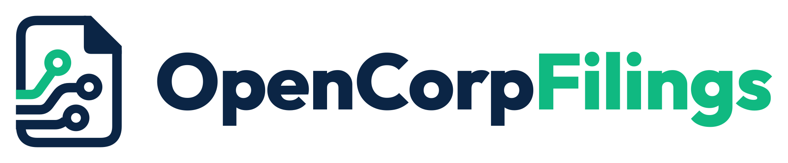

<p align="center">
  <picture>
    <source media="(prefers-color-scheme: dark)" srcset="brand/logo/opencorpfilings-logo-on-dark.svg">
    
  </picture>
</p>

<p align="center"><strong>Global company filings. One Python API.</strong></p>

<p align="center">
  <a href="https://github.com/SourceState-io/opencorpfilings/releases/tag/v1.0.2"></a>
  <a href="#install"></a>
  <a href="LICENSE"></a>
</p>

<p align="center">
  <a href="#quickstart">Quickstart</a> ·
  <a href="#coverage">Coverage</a> ·
  <a href="https://sourcestate-io.github.io/opencorpfilings/">Documentation</a> ·
  <a href="examples/notebooks/README.md">Notebooks</a> ·
  <a href="https://github.com/SourceState-io/opencorpfilings/actions/workflows/tests.yml">CI</a>
</p>

# OpenCorpFilings

A Python library for global company filings from SEC EDGAR, Companies House,
EDINET, France's AMF/DILA service and the European ESEF index. Retrieve
original reports and financial statements as filed, read document text,
and extract HTML tables and raw
XBRL/iXBRL facts through **one API**, with source IDs, dates and URLs preserved.

## Install

Release status: **1.0.2**. Install from GitHub; the package is not on PyPI.

```bash
pip install "opencorpfilings @ git+https://github.com/SourceState-io/opencorpfilings@v1.0.2"
```

<details>
<summary>Optional extras: PDF text, Markdown and pandas</summary>

Add only the extras your workflow needs:

```bash
pip install "opencorpfilings[pdf,markdown,pandas] @ git+https://github.com/SourceState-io/opencorpfilings@v1.0.2"
```

</details>

See [Getting started](docs/getting-started.md) for installation from a clone
and source credentials.

## Quickstart

Download Apple's latest annual report from SEC EDGAR:

```python
from opencorpfilings import Company

apple = Company("AAPL", market="US", user_agent="Alex Morgan alex@example.com")
filing = apple.filings(form="annual").latest()
print(filing)
filing.primary_document.download("apple-10k.htm")
```

Example output, captured in October 2026:

```text
<Filing 0000320193-25-000079 10-K ANNUAL period=2025-09-27 filed=2025-10-31 US/sec>
```

`Alex Morgan alex@example.com` illustrates the format: your name or
organization, a space, then your contact email. Replace it with your own
details; no SEC account or API key is needed. Alternatively, set
`OPENCORPFILINGS_SEC_USER_AGENT` and omit `user_agent=`. See
[SEC request identity](docs/getting-started.md#sec-request-identity) for
Python and terminal examples. A later run may select a newer filing.

The workflow is the same across markets. The company identifier changes:

```python
from opencorpfilings import Company

uk = Company("00185647", market="UK")              # Companies House number
fr = Company("969500XXRPGD7HCAFA90", market="FR")    # LEI

print(uk.filings(form="annual").latest())
print(fr.filings(form="annual").latest())
```

Neither example needs an API key. For Japan, use a securities or EDINET code
and a free EDINET API key; a filing-date window reduces discovery time.
See the [Japan guide](docs/markets/jp.md).

## Coverage

| Market | Filing source | Tier |
| :--- | :--- | :--- |
| [United States](docs/markets/us.md) | SEC EDGAR | **Supported** |
| [United Kingdom](docs/markets/uk.md) | Companies House | **Supported** |
| [Japan](docs/markets/jp.md) | EDINET | **Supported** |
| [France](docs/markets/fr.md) | AMF / DILA Info-Financière | **Supported** |
| [21 EU/EEA countries](docs/markets/esef.md) | ESEF index · filings.xbrl.org | Limited |
| [South Korea](docs/markets/experimental.md#korea-open-dart) | Open DART | Experimental |
| [ES, NL, DK, SE, PL, FI](docs/markets/experimental.md) | National filing sources | Experimental |

- **Supported:** each route passed a ten-issuer annual-report qualification
  in October 2026. The sample is not a market-wide coverage guarantee.
- **Limited:** the ESEF index provides tagged annual reports across 21
  countries but can lag national sources.
- **Experimental:** implemented routes emit a warning and may change in minor
  releases. European routes await promotion; Korea's document endpoint
  reported maintenance during qualification.

Form coverage and authentication vary by source. Inspect a route with
`ocf markets` or `provider_info("JP")` without network access. The
[market guides](docs/markets/index.md) document credentials, supported forms,
date filters and known gaps; [benchmarks](BENCHMARKS.md) record qualification
results and workflow timings.

## Common workflows

### Find a company

Search by name, ticker, securities code, ISIN or LEI, then open a matched
company on its filing source:

```python
from opencorpfilings import find_company

matches = find_company("FR0010307819")  # Legrand's ISIN
company = matches[0].company()
filing = company.filings(form="annual").latest()
print(filing)
```

The first search builds a local index from official company lists; later
calls reuse it for a week. Set `OPENCORPFILINGS_SEC_USER_AGENT` to include
US results. UK name search queries Companies House live and can return any
registered company; Korea is not indexed.
[Company search guide](docs/guide/finding-companies.md)

### Read a filing

With `filing` from the SEC quickstart:

```python
filing = apple.filings(form="annual").latest()

print(filing.text()[:400])
tables = filing.tables()
facts = filing.facts
item_7 = filing.section("Item 7")
```

| Content | Access | Scope |
| :--- | :--- | :--- |
| Original documents | `filing.documents`, `filing.primary_document` | Source files and archive packages |
| Text and Markdown | `filing.text()`, `filing.markdown()` | Depends on format and optional extras |
| PDF pages | `document.page(n)`, `document.pages` | Requires the `pdf` extra and a text layer |
| HTML tables | `filing.tables()` | Literal source rows and cells |
| XBRL/iXBRL facts | `filing.facts`, `filing.find_facts(...)` | Only where the original contains tagged data |
| SEC Items | `filing.section("Item 7")`, `filing.sections()` | 10-K, 10-Q and 8-K, where identifiable |

[Text, tables and facts guide](docs/guide/text-tables-facts.md) ·
[Document selection and archive members](docs/guide/documents.md)

### Save a company's filing history

Download a bounded selection with a resumable manifest:

```python
from opencorpfilings import Company

greggs = Company("00502851", market="UK")
greggs.filings(form="annual", limit=3).download("reports/greggs")
```

Each filing gets a folder. The manifest records source URLs, SHA-256 hashes
and file sizes; reruns skip completed downloads. A selection requires a
`limit=`, date window or explicit `all_history=True` and covers one company.
[Download guide](docs/guide/downloads.md)

## Command line

The `ocf` CLI uses the same API and returns JSON:

```bash
ocf find Toyota --limit 3
ocf filings 00185647 --market UK --form annual --limit 3
ocf documents 00185647 --market UK --form annual --latest
ocf download 00502851 --market UK --form annual --limit 3 --output-dir reports/greggs
ocf markets
```

[CLI reference](docs/guide/cli.md)

## Working with source data

Filing IDs and form codes remain the source's own. Filing dates, publication
times, reporting periods and index-addition dates stay separate; missing
dates are `None`. Raw fact values retain their filed strings, units and
dimensions. Financial statements are available within the original reports;
the library does not assemble standardized statement objects. Comparable
financial statements and accounting normalization belong in downstream tools.

Requests are paced per source host and retried with backoff. Credentials come
from arguments or environment variables; `.env` files are not loaded.
[Authentication setup](docs/getting-started.md#credentials) ·
[Errors and retries](docs/guide/errors.md) ·
[Identifiers and provenance](docs/concepts/identifiers-dates-provenance.md)

## Documentation and support

- [Documentation](docs/index.md) — installation, guides and market coverage.
- [Example notebooks](examples/notebooks/README.md) — complete workflows with
  stored outputs from live sources.
- [API reference](API.md) — public classes, methods and error types.
- [Changelog](CHANGELOG.md) and [stability policy](docs/stability.md) — release
  history and API guarantees.
- [Issues](https://github.com/SourceState-io/opencorpfilings/issues) — report
  bugs or request a filing source. Include the version, market and filing ID.
- [Contributing](CONTRIBUTING.md) — development setup and provider requirements.
- [Security](SECURITY.md) — report vulnerabilities privately; never post keys.

## License

[MIT](LICENSE) for the software. Filing documents retain their source-specific
[access and reuse terms](SOURCE_ACCESS.md). OpenCorpFilings is independent
of the regulators and data sources it reads.

Maintained by [SourceState](https://github.com/SourceState-io).
